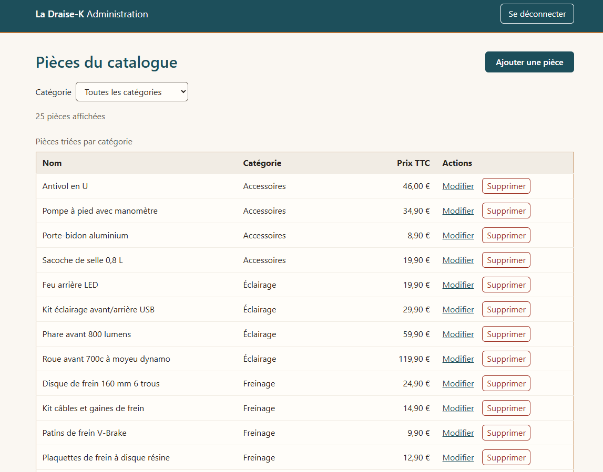
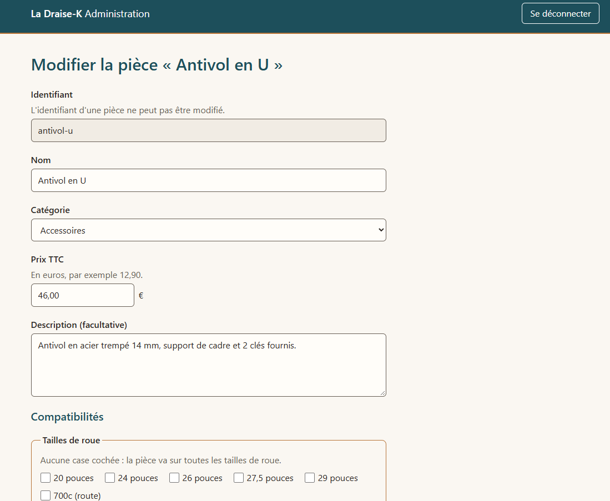

# La Draise-K – Administration

Back-office de La Draise-K ([dépôt](https://github.com/NadjiF/draise-k) · [site en ligne](https://draise-k.vercel.app)), pour gérer son catalogue de pièces détachées vélo.

Projet de démonstration : un seul administrateur, des données fictives, pas encore en ligne. Il complète La Draise-K avec ce qu'elle ne montrait pas : une API REST avec authentification, une base PostgreSQL, Docker et une interface Angular. Projet développé avec Claude Code comme assistant de programmation : cadrage, choix techniques et validation de chaque étape sont de mon fait.

## Fonctionnalités

- **Connexion** de l'administrateur. Les pages sont protégées dans l'interface comme dans l'API, et une session expirée renvoie vers la page de connexion avec un message.
- **Liste des pièces**, filtrable par catégorie.
- **Création et modification** d'une pièce dans un même formulaire : prix en euros, compatibilités en cases à cocher (tailles de roue, types de frein, nombres de vitesses).
- **Suppression** après confirmation dans une boîte de dialogue.
- Messages d'erreur et de confirmation en français.

## Aperçu





## Stack

- **API** : Node.js 26, Express 5, PostgreSQL 18 (bibliothèque `pg`), zod 4, argon2, jose 6, express-rate-limit, TypeScript 6.
- **Interface** : Angular 22 (signaux, formulaires réactifs), sans bibliothèque de composants.
- **Base** : PostgreSQL dans Docker Compose.
- **Tests** : Vitest 5, avec supertest pour l'API et jsdom pour l'interface.
- **Lint** : ESLint 10 et typescript-eslint, avec angular-eslint pour l'interface.
- **CI** : GitHub Actions.

## Organisation du dépôt

```
api/                  API REST (Express)
  db/init.sql         création de la table et catalogue initial (25 pièces de La Draise-K)
  scripts/            génération du hash du mot de passe administrateur
  src/                routes, validation, accès à la base, tests
admin/                interface d'administration (Angular)
docker-compose.yml    base de développement (db) et base de test (db-test)
.env.example          variables d'environnement à copier dans .env
```

## Choix techniques

- **Prix en centimes.** Les prix sont des entiers en centimes dans la base, l'API et le modèle de l'interface. Le formulaire les saisit en euros, sous forme de texte, et les convertit sans calcul à virgule flottante.
- **SQL écrit à la main et paramétré.** Pas d'ORM : les requêtes sont écrites en SQL avec `pg`, et les valeurs passent toujours par des paramètres (`$1`, `$2`…), jamais par concaténation de texte.
- **Une même règle vérifiée à trois niveaux.** Le format de l'identifiant, le nom non vide, le prix positif et les compatibilités sont vérifiés par le formulaire, puis par zod dans l'API, puis par des contraintes `CHECK` dans PostgreSQL. Pour les vitesses (de 1 à 13), chacun des trois niveaux a ses propres tests, dont un sur la contrainte `CHECK` en insérant directement en SQL.
- **Un format d'erreur unique.** L'API répond toujours `{ "erreur": "…", "details": [{ "champ": "…", "message": "…" }] }`. L'interface place chaque détail sous le champ concerné (par exemple `prixCentimes` sous le champ « Prix ») et affiche en haut du formulaire ceux qui ne correspondent à aucun champ.
- **Authentification.**
  - Le mot de passe est haché avec argon2id, et ce hash est stocké dans les variables d'environnement, pas en base.
  - La connexion renvoie un JWT signé avec jose, valable 2 heures. La lecture du catalogue est publique, la création, la modification et la suppression exigent ce jeton.
  - Les tentatives sont limitées à 5 échecs par adresse IP en 15 minutes.
  - L'identifiant et le mot de passe sont toujours vérifiés tous les deux, l'identifiant en temps constant : le temps de réponse ne révèle pas lequel est faux.
- **Tests sur une vraie base PostgreSQL.** Les tests de l'API utilisent une base dédiée (service `db-test`), recréée avant chaque test à partir du même `init.sql` que la base de développement. Ils refusent de s'exécuter sur une base dont le nom ne finit pas par `_test`.
- **Des tests vérifiés en cassant volontairement le code.** Pour les tests importants, on a retiré une vérification ou élargi une contrainte pour s'assurer qu'ils échouent bien. Plusieurs tests trop faibles ont ainsi été repérés et corrigés.
- **Angular zoneless, avec des signaux.** Sans zone.js : l'état des pages est fait de signaux et de valeurs calculées (`computed`). Les tests attendent la mise à jour de la page comme le ferait le navigateur (`whenStable`), sans la forcer.
- **Accessibilité.**
  - HTML sémantique, avec chaque champ relié à son libellé, à son aide et à son message d'erreur (`aria-describedby`, `aria-invalid`).
  - Cases à cocher regroupées dans des `fieldset`, avec le message d'erreur dans la légende.
  - Focus sur le premier champ en erreur, puis sur le titre de la liste après une confirmation. Annonces par `role="status"` et `role="alert"`.
  - Boîte de dialogue native (`<dialog>`) qui s'ouvre avec le focus sur « Annuler ».
  - Liens et boutons qui nomment leur pièce pour les lecteurs d'écran.
  - Contrastes vérifiés en thème clair et en thème sombre.

## Lancer le projet

Prérequis : Node.js 26 (version indiquée dans `.nvmrc`, `nvm use`) et Docker avec Docker Compose.

1. Copier le fichier d'exemple des variables d'environnement :

   ```bash
   cp .env.example .env
   ```

2. Dans `.env`, remplacer `POSTGRES_PASSWORD`, puis générer le secret des jetons et le coller dans `JWT_SECRET` :

   ```bash
   node -e "console.log(crypto.randomBytes(32).toString('base64url'))"
   ```

3. Installer l'API et générer le hash du mot de passe administrateur (12 caractères au moins, saisie masquée). La ligne affichée, apostrophes comprises, remplace `ADMIN_MOT_DE_PASSE_HASH` dans `.env` :

   ```bash
   cd api
   npm ci
   npm run hash-mot-de-passe
   ```

4. Démarrer la base, puis l'API :

   ```bash
   docker compose up -d db   # depuis la racine du dépôt
   cd api && npm run dev     # http://localhost:3000
   ```

   La base est créée et remplie par `api/db/init.sql` au premier démarrage du conteneur.

5. Dans un autre terminal, démarrer l'interface :

   ```bash
   cd admin
   npm ci
   npm start                 # http://localhost:4200
   ```

   Le serveur de développement d'Angular transmet les appels `/api` à l'API sur le port 3000 (`admin/proxy.conf.json`). L'identifiant de connexion est celui de `ADMIN_IDENTIFIANT` (`admin` par défaut).

## Tests

**API** : 119 tests, sur la base de test.

```bash
docker compose up -d db-test   # depuis la racine
cd api
npm test
npm run typecheck
npm run lint
```

`db-test` garde ses données en mémoire et n'est lancée qu'à la demande. Les tests utilisent leurs propres identifiants et leur propre secret, jamais ceux du `.env`.

**Interface** : 149 tests, sans base ni API (les réponses de l'API sont simulées).

```bash
cd admin
npm test                       # en continu ; npm test -- --watch=false pour une seule exécution
npm run lint
```

Le lint utilise ESLint avec angular-eslint, sur le TypeScript et les gabarits HTML, y compris les règles d'accessibilité des gabarits.

**CI** : deux workflows GitHub Actions, avec la version de Node de `.nvmrc` :

- `ci-api.yml`, à chaque push et à chaque pull request : vérification des types, lint et tests de l'API, sur une base PostgreSQL 18 démarrée pour l'occasion ;
- `ci-admin.yml`, seulement quand `admin/`, `.nvmrc` ou ce workflow change : lint, tests de l'interface en une seule exécution, puis compilation de production.

## Limites connues

- **Pas encore en ligne.** Derrière un proxy, il faudra régler `trust proxy` dans Express : sans cela, toutes les requêtes semblent venir de la même adresse, et la limite de tentatives bloquerait tout le monde à la fois. Il faudra aussi servir l'interface et l'API sous le même domaine, ou activer CORS dans l'API.
- **Jeton en `sessionStorage`.** C'est simple et la session prend fin à la fermeture de l'onglet, mais le jeton est lisible par JavaScript. Un cookie `httpOnly` le protégerait mieux en cas de faille XSS.
- **La Draise-K ne lit pas encore cette API.** La boutique utilise toujours son propre fichier de données : une modification faite ici ne s'y voit pas.

## Auteur

Nadji Fali — [GitHub](https://github.com/NadjiF)
